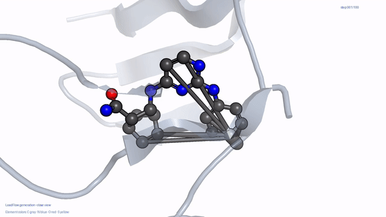
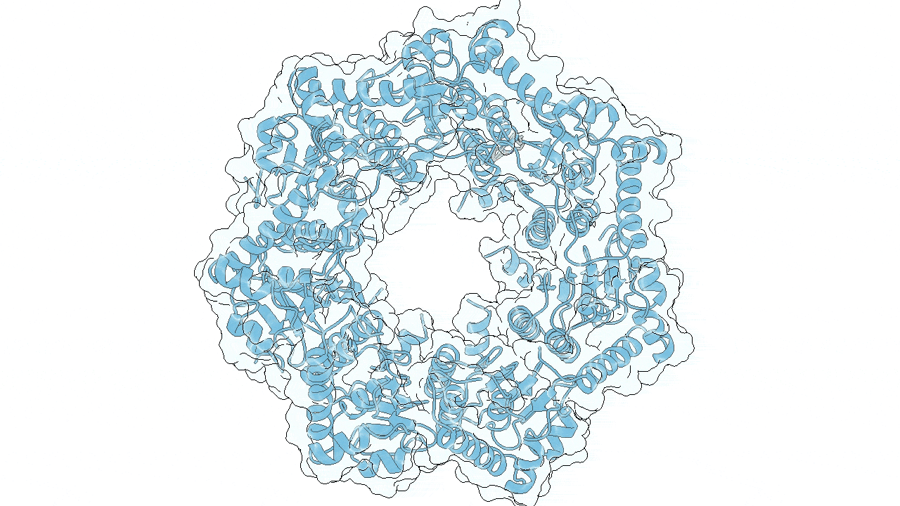

# LeadFlow

<table>
<tr>
<th align="center">IRAK4</th>
<th align="center">ClpP</th>
</tr>
<tr>
<td align="center"></td>
<td align="center"></td>
</tr>
<tr>
<td>Example ligand-generation trajectory for the active IRAK4 inhibitor recovered by LeadFlow-DPO (IC₅₀ = 0.003 μM; Fig. 6d,e).</td>
<td>Example ligand-generation trajectory for DC-ClpP-02 in the ClpP binding pocket (Fig. 7g–h).</td>
</tr>
</table>

## 🛠️ Environment setup
```bash
mamba env create -f environment_LeadFlow_260819.yml
conda activate LeadFlow

# PoseCheck: pin the version used to calculate strain energy in this work.
git clone https://github.com/cch1999/posecheck.git
git -C posecheck checkout 57a1938
python -m pip install -e posecheck
python -m pip install -r posecheck/requirements.txt
```

## 📦 Pretrained checkpoints

The pretrained BFN and DPO checkpoints are available from
[Zenodo](https://doi.org/10.5281/zenodo.22116036). Download `checkpoints.zip`, then
extract it from the repository root:

```bash
unzip Path/to/checkpoints.zip -d .
```

## 🚀 Quick Start: Sampling

Two sampling templates are provided:

- `scripts/sampling_template.sh` uses the standard BFN checkpoint.
- `scripts/dpo_sampling_template.sh` uses the DPO checkpoint.

The sampling parameters are summarized below. Replace every `Path/to/...`
placeholder before running a template.

| Parameter | Description |
| --- | --- |
| `--protein_path` | Target protein structure in PDB format |
| `--ligand_path` | Reference ligand in SDF format in its protein-bound pose. It provides the binding coordinates used to position the scaffold within the protein structure. |
| `--scaffold_path` | Scaffold in SDF format, obtained by removing the ligand atoms or groups that should not be retained. It defines the fixed substructure to preserve during generation and must match a substructure of the reference ligand. The matched scaffold coordinates in the ligand-bound pose are used to define the surrounding protein pocket. |
| `--sample_num_atoms` | Atom-count sampling strategy. `prior` samples the number of atoms based on the sizes of the protein pocket and scaffold, and is the default and recommended setting. `ref` uses the number of atoms in the reference ligand provided by `--ligand_path`. |
| `--output_path` | Directory for generated molecules and results |
| `--batch_size` | Number of samples processed per batch |
| `--num_samples` | Total number of molecules to generate |
| `--seed` | Random seed |
| `--devices` | GPU device indices |

All relative paths are resolved from the current working directory. Run either
template from the repository root:

```bash
# Standard BFN sampling
bash scripts/sampling_template.sh

# DPO sampling
bash scripts/dpo_sampling_template.sh
```

## 🗂️ Dataset

The raw data and preprocessed dataset used in this work are available from
[Zenodo](https://doi.org/10.5281/zenodo.22116036). Download `data.zip` and extract
it from the repository root:

```bash
unzip Path/to/data.zip -d .
```

This creates the following directory structure:

```text
data/
└── chembl/
    ├── raw/
    │   ├── train.csv                         # Training metadata, affinities, and scaffold annotations
    │   ├── val.csv                           # Validation metadata, affinities, and scaffold annotations
    │   ├── test.csv                          # MolGenBench test identifiers and scaffold annotations
    │   ├── train/                            # Training protein–ligand structures grouped by molecular series
    │   │   └── Sries*/
    │   │       ├── *_prep.pdb                # Prepared protein structure
    │   │       ├── *_lig*.sdf                # Protein-bound ligand poses
    │   │       └── *_scaffold_info_*.csv     # Per-series scaffold annotations
    │   ├── val/                              # Validation structures in the same format as train/
    │   ├── test/                             # MolGenBench structures grouped by protein target
    │   │   └── <target>/
    │   │       ├── *_prep.pdb                # Prepared protein structure
    │   │       └── *.sdf                     # Protein-bound ligand poses
    │   ├── affinity_info_all.pkl             # Ligand affinity metadata used for DPO training
    │   └── dpo_pair_dict_threshold5.pkl      # Preferred/non-preferred ligand pairs at a 5-fold threshold
    └── processed/
        ├── train.pt                          # Featurized training split
        ├── val.pt                            # Featurized validation split
        ├── test.pt                           # Featurized MolGenBench test split
        ├── pre_transform.pt                  # Saved preprocessing transform metadata
        └── pre_filter.pt                     # Saved preprocessing filter metadata
```

The archive already contains the processed files and can be used directly. To
rebuild them from the raw data, run:

```bash
# Create the training and validation datasets and DPO metadata
python create_dataset.py chembl --transform bond --stage fit

# Create the MolGenBench test dataset
python create_dataset.py chembl --transform bond --stage test
```

The first command creates `processed/train.pt`, `processed/val.pt`,
`raw/affinity_info_all.pkl`, and `raw/dpo_pair_dict_threshold5.pkl`. The second
creates `processed/test.pt`. Preprocessing metadata is also saved as
`processed/pre_transform.pt` and `processed/pre_filter.pt`.

## 🏋️ Training

The BFN and DPO training configurations used in this work can be launched
directly with the provided scripts. Run them from the repository root:

```bash
# Train the BFN model from scratch
bash train_bfn_bond.sh

# Train the DPO model from the pretrained BFN checkpoint
bash train_bfn_dpo.sh
```

`train_bfn_bond.sh` starts BFN training from scratch using
`configs/default_bond.yaml`. `train_bfn_dpo.sh` initializes DPO training from
the pretrained BFN checkpoint configured in the script. Training outputs and
checkpoints are saved under `logs/`.

## 🧪 Testing

After downloading and extracting the pretrained checkpoints, use the following
scripts to sample molecules on MolGenBench from the repository root:

```bash
# Sample molecules with the pretrained BFN model
bash test_bfn_prior_bond.sh

# Sample molecules with the pretrained DPO model
bash test_bfn_prior_bond_dpo.sh
```

## 📊 Sampling and evaluation results

The molecules sampled on MolGenBench and their evaluation results are available
from [Zenodo](https://doi.org/10.5281/zenodo.22116036):

- `LeadFlow_sampling_results.zip` contains the generated and Vina-docked
  molecules from the BFN and DPO models, together with the corresponding
  MolGenBench evaluation results.
- `LeadFlow_ablation.zip` contains the generated molecules and corresponding
  MolGenBench evaluation results for the Rxn, Bemis–Murcko scaffold, and
  docking-based DPO ablations.

## 🧩 Ablation experiments

Download `LeadFlow_ablation.zip` from
[Zenodo](https://doi.org/10.5281/zenodo.22116036) and extract it together with
`data.zip` from the repository root:

```bash
unzip Path/to/data.zip -d .
unzip Path/to/LeadFlow_ablation.zip -d .
```

The ablation datasets are derived from the original ChEMBL training and
validation molecules. Following the data-construction procedure of
[DiffDec](https://github.com/biomed-AI/DiffDec), the Rxn variant generates
scaffold–decoration pairs by reaction-based slicing, while the Bemis–Murcko
variant extracts the RDKit Bemis–Murcko scaffold from each ligand. The
docking-DPO variant uses the same
within-series pairs selected by a five-fold experimental-affinity threshold and
reorders each pair by Glide docking score, with more negative scores preferred.

Run the ablation training scripts with:

```bash
bash scripts/ablation/train_bfn_bond_Rxn.sh
bash scripts/ablation/train_bfn_bond_bmscaffold.sh
bash scripts/ablation/train_bfn_dpo_docking_score.sh
```

Evaluate the corresponding checkpoints on MolGenBench with:

```bash
bash scripts/ablation/test_bfn_prior_bond_Rxn.sh
bash scripts/ablation/test_bfn_prior_bond_bmscaffold.sh
bash scripts/ablation/test_bfn_prior_bond_dpo_docking.sh
```
